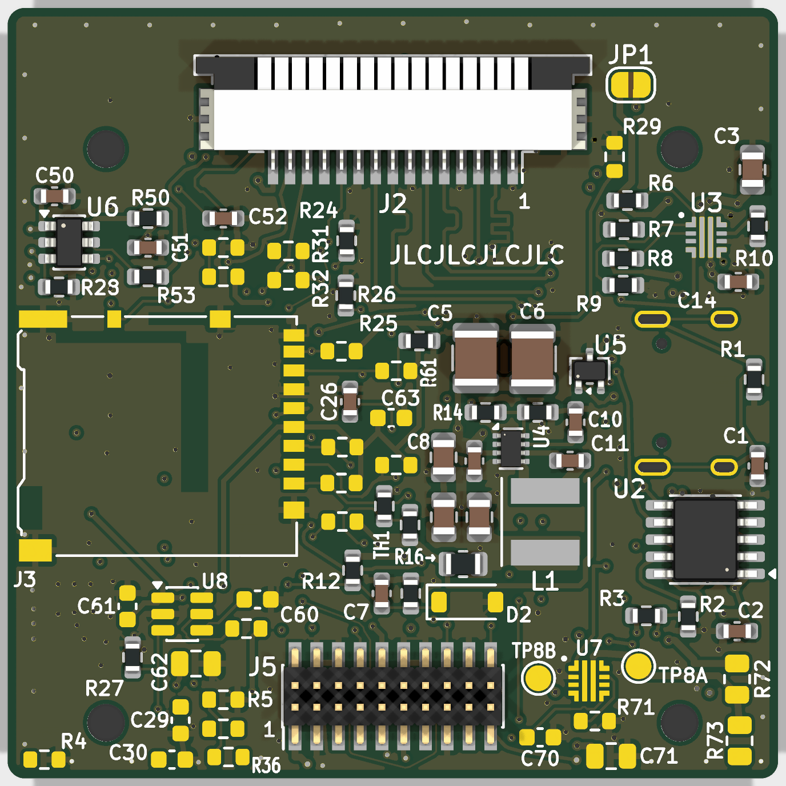
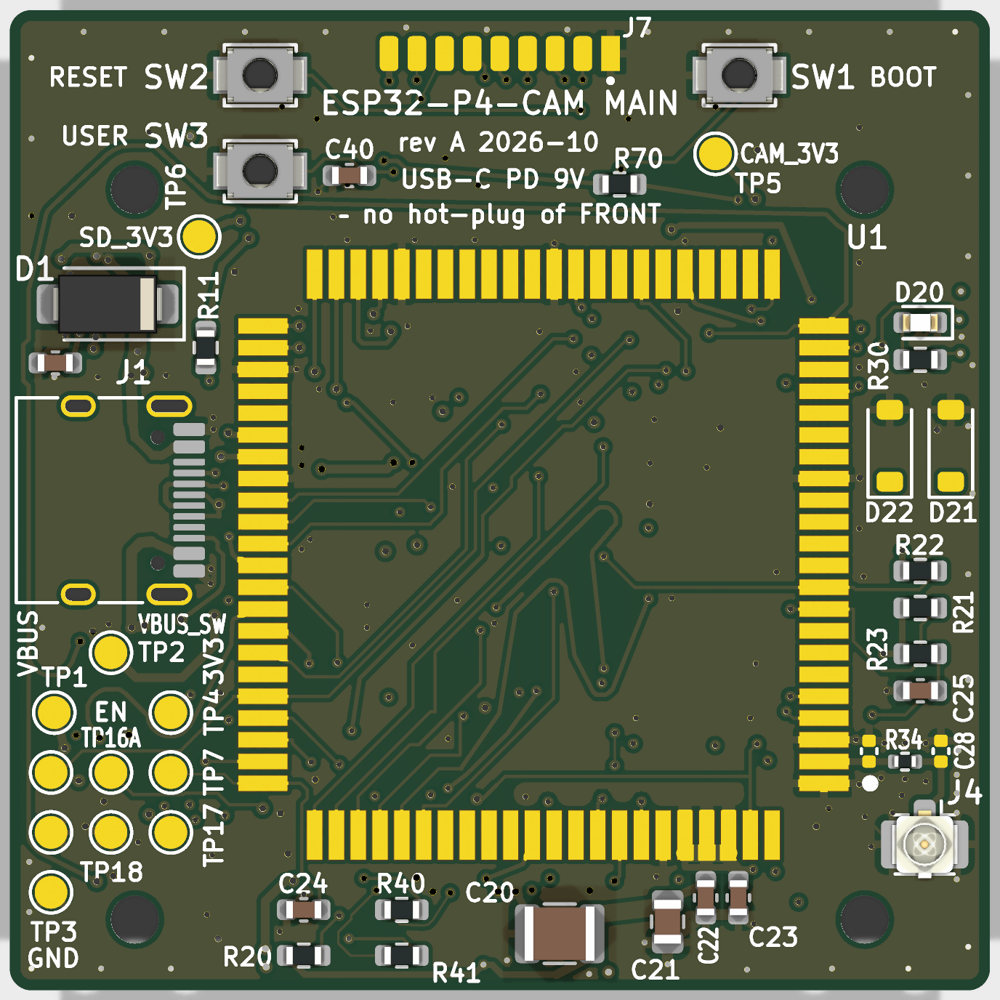

# ESP32-P4-CAM

A compact WiFi streaming camera built around the ESP32-P4. The camera streams live video over WiFi (RTSP, hardware H.264). The design uses a two-board stack, FRONT and MAIN, both 45 × 45 mm, with a 7 mm gap between them. Power comes from a single USB-C port that negotiates 9 V over USB Power Delivery.

This repository holds the hardware design (KiCad 10) and its documentation. There is no firmware in it yet.

| MAIN rev A, top (F) side | MAIN rev A, bottom (B) side |
|---|---|
|  |  |

## What it is

```
USB-C (PD 9 V, 5 V fallback) ─ TVS ─ eFuse ─ buck 3.3 V ─┬─ Waveshare ESP32-P4-Module (P4 + on-module ESP32-C6)
                                                          └─ CAM_3V3 load switch ─ OV5640 camera module

OV5640 ─ MIPI CSI-2 (2 lanes) ─ ESP32-P4 ISP ─ H.264 ─ RTSP ─ esp-hosted (SDIO) ─ ESP32-C6 WiFi ─ u.FL antenna
```

- **Compute:** a [Waveshare ESP32-P4-Module](https://www.waveshare.com/wiki/ESP32-P4-Module). The module carries an ESP32-P4 with 32 MB PSRAM in the package, 16 MB of flash, and an **ESP32-C6 on the module itself**, which provides WiFi to the P4 over SDIO through esp-hosted. The module is mounted on the bottom side of MAIN and soldered by hand.
- **Camera:** an OV5640 connected over MIPI CSI-2 (2 lanes), using a 15-pin, 1.0 mm FPC with the Raspberry Pi pinout. The camera module must have its own oscillator and LDOs.
- **Power:** USB-C PD sink, VBUS limited to 9 V.
  - A WCH CH224A negotiates 9 V. It is configured with a fixed resistor strap and its PG pin goes to a GPIO.
  - A TI TPS259470 eFuse provides OVLO, UVLO, current limit, reverse blocking and auto-retry.
  - A TI TPS62933F forced-PWM buck produces the 3.3 V rail.
  - USB-C is the only power input.
- **Programming:** the first flash goes over USB-C to the P4's built-in USB-Serial-JTAG (GPIO 24/25, Full Speed only). After that, both the P4 and the C6 are updated over the air (OTA).
- **Stack:**
  - **FRONT** board: lens cut-out, IR LEDs and driver, PDM microphone.
  - **MAIN** board: everything else.
  - The two boards are joined by 4 M2 standoffs plus a 2 × 10, 1.27 mm board-to-board header (J5). The camera FFC plugs into J2 on MAIN.

Rev A is a **proof-of-concept prototype**. Its job is to prove the core path: USB-C PD → eFuse → buck → P4 → OV5640 → H.264 → RTSP over the C6. The target is 1080p30, running 24 hours without a reset. Blocks outside that path are either footprints that are not fitted (DNP: microSD, the IR branch, the CC tap) or deferred to rev B (the reset supervisor and the ICR, which are not on the board).

## Current status (2026-10-12)

| Item | State |
|---|---|
| **MAIN rev A layout** | **Complete and reviewed.** 4 layers, JLC04101H-3313A, 45 × 45 mm. |
| Checks (`kicad-cli`, no zone refill) | **DRC 0 errors**, **ERC 0**, **schematic ↔ board parity 0**. **12 unconnected items, all on DNP parts.** There are also 37 `track_width` warnings from a custom power-net rule; they were reviewed and accepted. |
| Ordering | **Conditional GO.** You can order once the owner checks in [`kicad/MAIN/fab/ORDERING.md`](kicad/MAIN/fab/ORDERING.md) are done: the JLC form settings, rotations in the placement preview, the USB-C shell legs, stock reservations and accepting the U5 second source (its pinout is already checked). |
| Open owner decisions | **Q6:** which side of J2 has the contacts, plus the FFC type. **Q17:** the mated height of J5. Neither one blocks PCB fabrication. The remaining BOM confirmations are listed in [`BOM_NOTES.md`](kicad/MAIN/fab/BOM_NOTES.md) §10. |
| **FRONT board** | **Not started.** Waiting on gate **G6**, which needs a stable image from MAIN bring-up (G5b) and the camera's STEP model. |
| Firmware | Not started in this repo. Rev A firmware constraints are listed in `ORDERING.md` ("Firmware rules for rev A"). |

> The 12 unconnected items are DNP-only branches: CC1/CC2 and their ADC taps, and U7/R73. **Route them before you ever fit those parts.**

## Key specs

| Parameter | Value |
|---|---|
| Function | WiFi live-view camera: RTSP stream, hardware H.264. Rev A target is 1080p30 (the real figure gets fixed at G0). |
| Host module | Waveshare ESP32-P4-Module: ESP32-P4NRW32 + 16 MB flash + on-module ESP32-C6H8 (SDIO). 25 × 25 × 3.3 mm, 88 castellated pads at a 1.0 mm pitch |
| Wireless | ESP32-C6 through esp-hosted. Antenna on the J4 u.FL (Hirose U.FL-R-SMT-1); the module's own IPEX connector is an alternative (antenna decision Q25 still open). |
| Camera | OV5640, MIPI CSI-2 with 2 lanes, through J2 (TE 1-84953-5, 15-pin, 1.0 mm FPC, Raspberry Pi pinout). Supplied from a switched CAM_3V3 rail (TPS22917). |
| Power input | USB-C 16-pin (HRO TYPE-C-31-M-12), USB PD sink at **9 V** via the WCH CH224A. Falls back to 5 V on a non-PD or PC port (reduced "LOW" mode). |
| Input protection | SMAJ10A TVS, plus a TI TPS259470ARPWR eFuse: UVLO 4.40 / 4.00 V, OVLO 10.87 / 9.88 V, ILIM 2.03 A, reverse blocking, auto-retry |
| 3.3 V rail | TI TPS62933F synchronous buck (FCCM): 3.33 V, 3 A, 1.2 MHz, 2.2 µH |
| Power budget (estimate, not yet measured) | About 2.2 W typical and 4.4 W peak with IR off; about 5.6 W peak at night with IR on (the IR is on FRONT). |
| MAIN PCB | 45 × 45 mm. 4 layers on **JLC04101H-3313A**, finished thickness 0.97 mm (order as 1.0 mm). ENIG finish, impedance control, components on both sides. |
| Impedance (L1 / L4, referenced to GND) | RF 50 Ω: 0.302 mm · CSI 100 Ω diff: 0.204 / 0.203 mm · USB 90 Ω diff: 0.262 / 0.203 mm |
| Layer usage | L1 signals + parts · L2 solid GND · L3 power islands + GND fill · L4 module + signals |
| Stack | FRONT + MAIN, **7 mm gap**. 4 × M2 standoffs on a 33.5 mm grid; the grid centre is (22.5; 25.0), 2.5 mm below the board centre. J5 is a 2 × 10, 1.27 mm board-to-board connector. |
| Assembly | 72 placements (47 top / 25 bottom), 40 BOM lines, all with LCSC numbers. The P4 module (U1) is soldered by hand after SMT. |
| User I/O | BOOT, RESET and USER buttons, a status LED, and 12 bottom-side test pads. The C6 UART/boot pad row (J7) is DNP. |

## Repository layout

```
.
├── README.md
├── docs/                      English documentation (primary from 2026-10-12 on)
│   ├── README.md              documentation index and conventions
│   ├── 00-requirements.md … 09-pcb-layers.md, 90-review-log.md
│   ├── img/                   board renders and routing snapshots
│   └── hu/                    Hungarian originals, frozen 2026-10-12 (no longer maintained)
├── kicad/
│   ├── MAIN/                  KiCad 10 project of the MAIN board, rev A
│   │   ├── ESP32-P4-CAM-MAIN.kicad_pro / .kicad_sch / .kicad_pcb / .kicad_dru
│   │   ├── 01_tap.kicad_sch        power: USB-C, CH224A, eFuse, buck, USB ESD
│   │   ├── 02_p4_modul.kicad_sch   ESP32-P4 module, RF/u.FL, straps, status LED, NTC
│   │   ├── 03_kamera.kicad_sch     camera FPC J2, CAM_3V3 load switch
│   │   ├── 04_prog_tp.kicad_sch    buttons, C6/UART0 pad row J7, test points
│   │   ├── 05_b2b_front.kicad_sch  J5 board-to-board header to FRONT, IR branch (DNP)
│   │   ├── 06_sd.kicad_sch         microSD (DNP)
│   │   ├── scripts/           layout automation (placement, routing, merge): see scripts/README.md
│   │   └── fab/               JLC fabrication + assembly package (Gerber, BOM, CPL, ORDERING.md); hu/ = frozen Hungarian originals
│   ├── lib/                   project library ESP32-P4-CAM: custom symbols + footprints
│   └── archive/               abandoned 2-layer 60 × 50 mm MAIN attempt (2026-10-09, not fully routed)
└── ref/                       third-party datasheets + Waveshare land pattern (local only, git-ignored)
```

`ref/` is excluded from the repository for copyright reasons. Download the files from the links in [Third-party references](#third-party-references).

## Documentation

The English documents are the primary source; [`docs/README.md`](docs/README.md) is the index, with the conventions and markers used throughout. The Hungarian originals in [`docs/hu/`](docs/hu/) (and [`kicad/MAIN/fab/hu/`](kicad/MAIN/fab/hu/)) were frozen on 2026-10-12 and are no longer maintained. **Where documents disagree, `05-architecture.md` wins.**

| Doc | Content |
|---|---|
| [00-requirements](docs/00-requirements.md) | Goal, mandatory requirements (K1–K8), extra features, document map |
| [01-esp32-p4](docs/01-esp32-p4.md) | ESP32-P4 research: variants, power, boot, camera interfaces |
| [02-esp32-c6-and-programming](docs/02-esp32-c6-and-programming.md) | C6 options, esp-hosted P4 ↔ C6 link, programming both chips, power |
| [03-camera-ov5640](docs/03-camera-ov5640.md) | OV5640 interface, FPC connector, camera power rails |
| [04-peripherals](docs/04-peripherals.md) | microSD, microphone, IR, buttons/LED, USB-C power |
| [**05-architecture**](docs/05-architecture.md) | **Authoritative.** Rev A plan (§0: fit/DNP, gates, procurement), primary-source facts, PCB stack and the frozen mechanical interface (§3.1a), stackup (§3.2), power tree and budget (§4), GPIO map, connectors, bring-up sequence (§15) |
| [06-floorplan](docs/06-floorplan.md) | Area and height budget (7 mm gap), floorplan, as-built placement |
| [07-bom-plan](docs/07-bom-plan.md) | BOM with MPN/LCSC numbers, value calculations, USB-C pin map |
| [08-diagrams](docs/08-diagrams.md) | Block and connection diagrams (Mermaid) derived from 05 |
| [09-pcb-layers](docs/09-pcb-layers.md) | As-built MAIN rev A layer plots (L1–L4, mask/silkscreen, 3D views), stackup and copper statistics |
| [90-review-log](docs/90-review-log.md) | Full history of the design and review rounds, with corrections |

## Opening and checking the design

You need **KiCad 10.0** or newer. The files use the KiCad 10 format (board version `20260206`) and do not open in KiCad 9.

1. Open `kicad/MAIN/ESP32-P4-CAM-MAIN.kicad_pro`.
   - The project library is resolved as `${KIPRJMOD}/../lib`, so keep the `kicad/` folder structure as it is.
2. Run the checks from the command line. On macOS, `kicad-cli` is at `/Applications/KiCad/KiCad.app/Contents/MacOS/kicad-cli`; on Linux and Windows it is on `PATH`.

   ```sh
   cd kicad/MAIN
   kicad-cli pcb drc --schematic-parity --severity-all --format json -o drc.json ESP32-P4-CAM-MAIN.kicad_pcb
   kicad-cli sch erc --severity-all --format json -o erc.json ESP32-P4-CAM-MAIN.kicad_sch
   ```

   Expected results:
   - DRC: **0 errors**, 37 `track_width` warnings, **12 unconnected** (all DNP), **0 parity issues**.
   - ERC: **0**.
   - Write the reports somewhere outside the repo, or delete them afterwards.

3. **Refill and save zones only inside `kicad/MAIN`.**
   - The command is `kicad-cli pcb drc --refill-zones --save-board …`.
   - The `.kicad_pro` and `.kicad_dru` files must sit next to the board when you do this. If you refill outside the project folder, the project rules are lost, including the 1 mm edge clearance for power zones, and the fills come out wrong.

> [!WARNING]
> **The KiCad GUI can overwrite `.kicad_pro` with stale settings when it closes.**
>
> This has happened twice. Closing the GUI wrote back an old in-memory copy of the project, which reverted the 4-layer rules to 2-layer values. DRC then reported hundreds of errors.
>
> After every GUI session, run `git diff kicad/MAIN/ESP32-P4-CAM-MAIN.kicad_pro` and check the design rules:
> - min track 0.09 mm, min drill 0.2 mm, min via 0.45 mm, clearance 0.15 mm
> - netclasses: Default 0.15, PWR 0.4, PWR_LIGHT 0.3, RF_50 0.302, CSI_DIFF 0.204/0.203, USB 0.262/0.203
> - the `netclass_patterns`
>
> If they reverted, restore the file from git or re-run `kicad/MAIN/scripts/project_rules.py` (see the [scripts README](kicad/MAIN/scripts/README.md); it has hardcoded paths). Then re-run DRC. If scripts are modifying the board, do not keep it open in the GUI.

## Fabrication and ordering (quick start)

Everything you need is in [`kicad/MAIN/fab/`](kicad/MAIN/fab/). Start with **[`ORDERING.md`](kicad/MAIN/fab/ORDERING.md)**; the part-selection rationale is in [`BOM_NOTES.md`](kicad/MAIN/fab/BOM_NOTES.md).

1. Re-run the pre-order gate from `ORDERING.md` on the board you are about to order:
   - refill and save inside the project folder;
   - DRC without refill gives 0 errors, 12 DNP-only unconnected, parity 0;
   - ERC gives 0.
   - If the board has changed, regenerate the package (`kicad-cli pcb export gerbers --check-zones …` and `pcb export drill --excellon-separate-th …`, then BOM/CPL).
2. Upload `gerber_jlc.zip`, `BOM_jlc.csv` and `CPL_jlc.csv` (72 rows) to JLCPCB.
3. Set the PCB form:
   - 4 layers, 45 × 45 mm, 1.0 mm thick;
   - **stackup JLC04101H-3313A**, **impedance control on**, **ENIG**;
   - tented vias;
   - frame rails on the top and bottom edges only, with **no tab on the right edge**.
4. Check rotation and pin 1 in the JLC placement preview, and decide how the USB-C shell legs get soldered.
5. Reserve the low-stock parts before you order.
6. The P4 module is **not** in the BOM. Solder it by hand, then do the pre-power ohmmeter checks from `ORDERING.md`.

## Design-review history

- **Round 7 (2026-10-10):** a 15-agent PCB review (7 domain experts, a sceptical re-measurer for each domain, and a gap-finder who wrote the summary) gave **NO-GO**. Findings included the buck hot loop, the RF reference plane, GND stitching, the BOM gate and the ESP_EN pull-up.
- **Round 8 (2026-10-10/11):** **two parallel fix passes**. Each agent worked on its own fenced board region and the changes were merged by UUID (`kicad/MAIN/scripts/pcbmerge.py`, `regioncheck.py`). An independent checker re-measured every fix.
- **Round 9 (2026-10-11):** a 16-agent final review gave **conditional GO**. No design changes were needed. The only critical item was stale zone fills, a process issue, fixed by refilling and saving inside the project folder.

Details are in [`docs/90-review-log.md`](docs/90-review-log.md).

## Gates (rev A)

Full definitions and exit criteria are in [`05-architecture.md` §0.2](docs/05-architecture.md).

| Gate | Content | Status |
|---|---|---|
| G0 | Dev-kit stream test: OV5640 → ISP → H.264 → RTSP over the C6, a 24-hour soak, and current measurements. Freeze the SDK and component versions. | open |
| G1 | CH224A breakout bench test: 9 V PDO, strap, PG polarity, DP/DM left unconnected | open |
| G2 | Module schematic, footprint and antenna decision | partial: footprint built from the Waveshare land pattern and verified; module schematic questions and antenna choice still open |
| G3 | Freeze the camera module: lens, STEP model, FFC lengths, final J2 contact side (Q6) and CSI pin order (Q24) | open |
| G4 | BOM sheet complete (MPN / LCSC for every fitted part) | **closed for rev A** (2026-10-11) |
| G5 | MAIN schematic → layout → DRC → order | layout done, **conditional GO**; next is the order (see ORDERING.md) |
| G5b | Bring-up: MAIN on its own, camera on a 50–100 mm FFC, CSI soak test with error counters | pending |
| G6 | FRONT board: IR, microphone (ICR in rev B) | not started; begins after G5b |

## Third-party references

The datasheets are **not** redistributed in this repository. Get them from the vendors:

- **TI TPS25947 / TPS259470 eFuse** (the TPS259470ARPWR is a TPS25947xx variant). Datasheet SLVSFC9: <https://www.ti.com/lit/ds/symlink/tps25947.pdf>. Product page: <https://www.ti.com/product/TPS25947>
- **TI TPS62933 / TPS62933F buck.** Datasheet SLUSEA4: <https://www.ti.com/lit/ds/symlink/tps62933.pdf>. Product page: <https://www.ti.com/product/TPS62933>
- **WCH CH224 (CH224A / CH224Q) USB PD sink.** Product page: <https://www.wch-ic.com/products/CH224.html> (Chinese site: <https://www.wch.cn/products/CH224.html>). The design used the Chinese datasheet "CH224 手册1", v2.1.
- **Waveshare ESP32-P4-Module.** Wiki with pinout, schematic and the PCB land-pattern ZIP: <https://www.waveshare.com/wiki/ESP32-P4-Module>
- **Espressif ESP32-P4:**
  - product page: <https://www.espressif.com/en/products/socs/esp32-p4>
  - datasheet: <https://www.espressif.com/sites/default/files/documentation/esp32-p4_datasheet_en.pdf>
  - technical reference manual: <https://www.espressif.com/sites/default/files/documentation/esp32-p4_technical_reference_manual_en.pdf>
  - ESP-IDF programming guide: <https://docs.espressif.com/projects/esp-idf/en/latest/esp32p4/>
- **Related software:**
  - esp-hosted-mcu: <https://github.com/espressif/esp-hosted-mcu>
  - esp-video-components (esp_cam_sensor): <https://github.com/espressif/esp-video-components>
- **Stackup and impedance:** JLCPCB impedance calculator: <https://jlcpcb.com/pcb-impedance-calculator>

## License

Private project — all rights reserved (no license granted yet).
