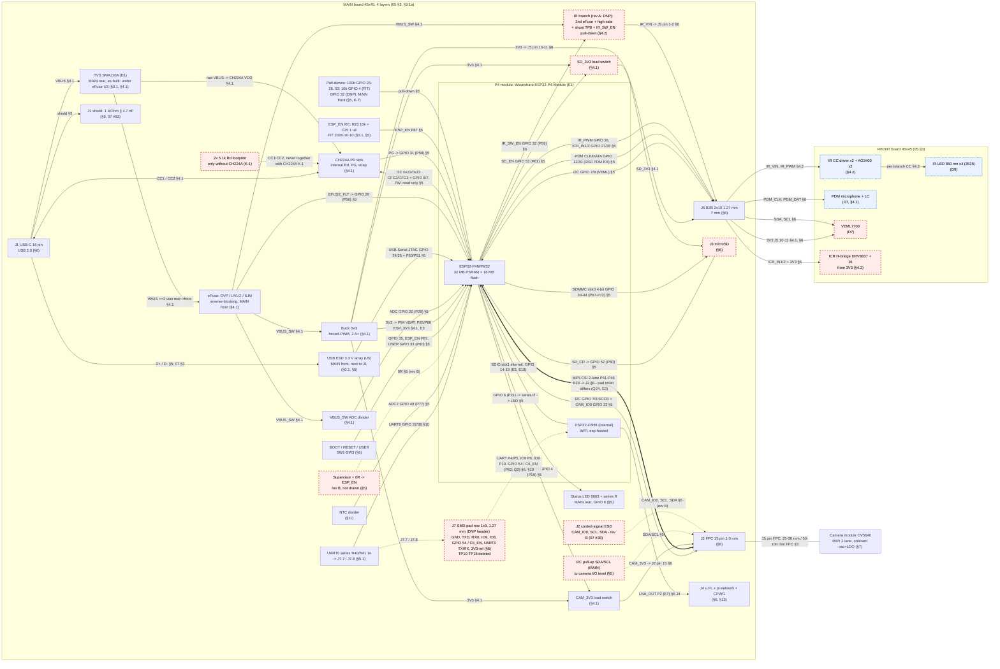
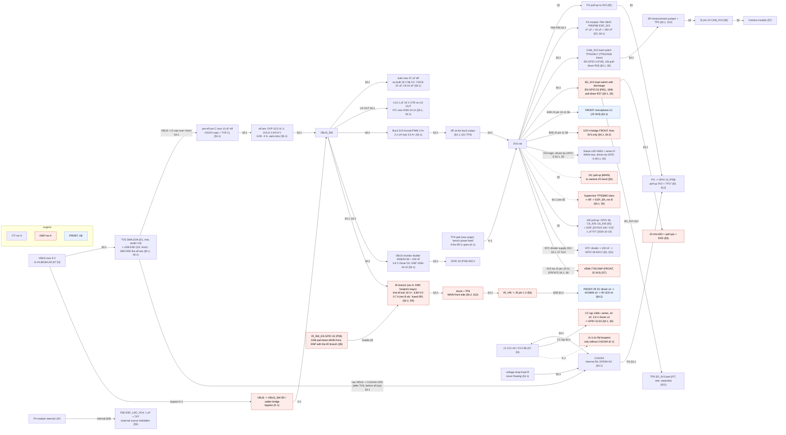
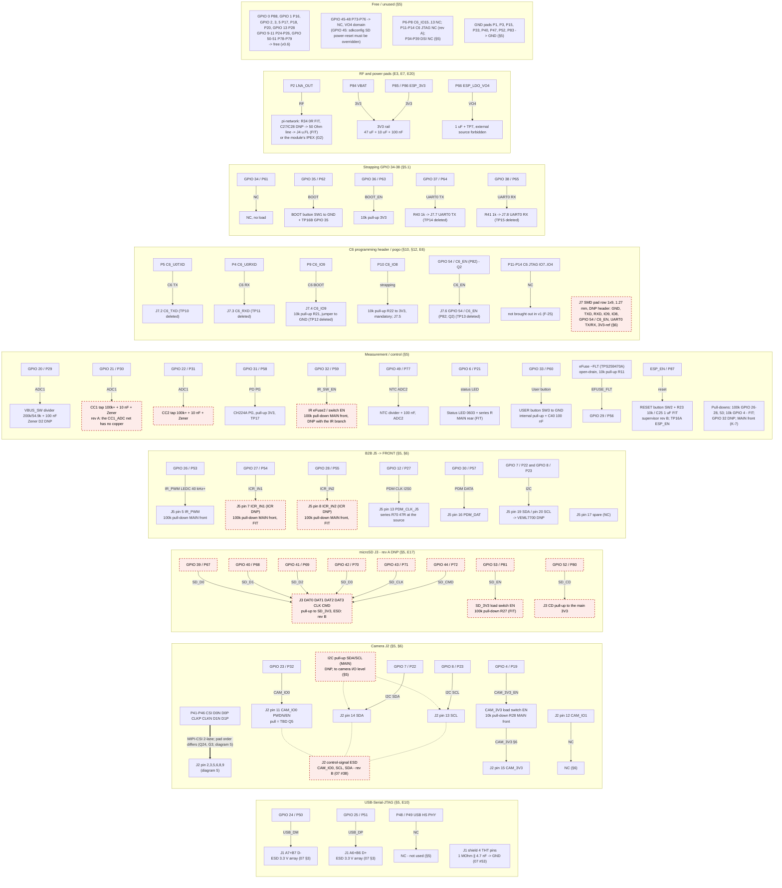
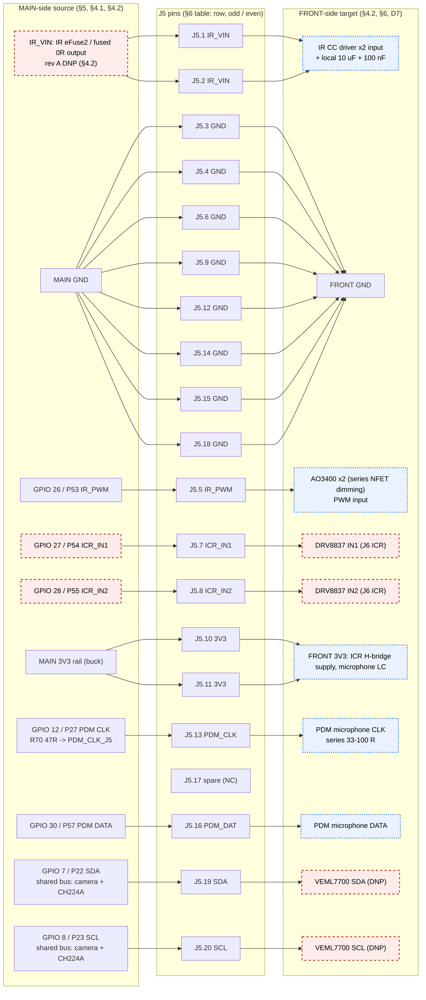
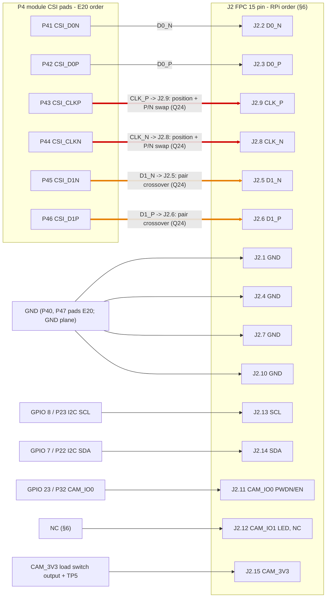
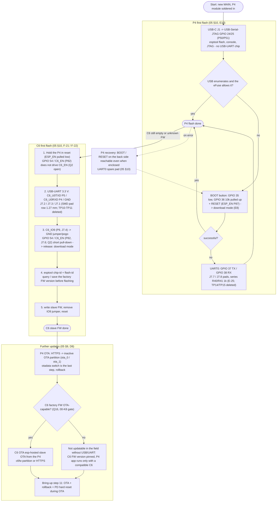

# 08 – Diagrams (Mermaid, v0.4)

Date: 2026-10-09 · **v0.4 (2026-10-11): final rev A as-built – D1 TVS under U3, U5 / R1 / C1 on the front side, new C14, G4 closed, G5 pre-order gate, G5b CSI soak** – see "Diagram corrections (v0.4)" at the end · **v0.3 (2026-10-10): GPIO assignment v0.6 (SD_EN 53, SD_CD 52, CAM_3V3_EN 4, USER 33, EFUSE_FLT 29, PDM_DATA 30), MAIN 45×45 / 4 layers, as-built TPs (TP9–TP15 deleted, C6/UART0 on the J7 pad row), 2026-10-10 decisions (R23/C25 FIT, D2 DNP, R28 10k, camera control-signal ESD → rev B)** – see "Diagram corrections (v0.3)" at the end · Source: `05-architecture.md` v0.5 (authoritative), `06-floorplan.md` v0.3, `07-bom-plan.md` v0.2 · **v0.2 (R4): the issue list has been fixed, the diagrams show the corrected state of 05/06/07** (see "Diagram corrections" at the end) · The diagrams are built **exclusively** from the tables / text of 05; 06 and 07 serve only to supplement the board side (front / rear) and the pin map where 05 is silent (this is indicated by the edge label).

## Legend (for all diagrams)

| Notation | Meaning |
|---|---|
| Solid arrow, `§n` on the edge label | the connection appears in the given section of 05 (`E20` = 05 §1 pad map, `07 §3` = USB-C pin map) |
| Dashed arrow | DNP branch or optional connection (the v0.1 "MISSING FROM 05" edges have all been recorded after the fixes, see the issue list) |
| Node with a dashed **red** border | rev A **DNP** (05 §0.1; footprint present, not fitted) |
| Node with a dashed **blue** border | **later (G6)**, on the FRONT board (05 §0.1, §0.2) |
| Plain border | rev A **FIT** |

Module pad = `P` number, processor pin = `GPIO n` (05 notation rule). The spatial arrangement of the pin numbering is **[F]** (assumption) until the footprint import (05 §14, 06 §1) – **v0.3: the footprint has been imported and matches the DXF; the GPIO ↔ pad ↔ net assignment has been checked against the U1 pads of the PCB (05 §5).**

---

## 1. System block diagram

Notes: the status LED is on the back side of MAIN (driven by GPIO 6), J5.17 is spare (NC). ~~The TVS + USB ESD sit on the MAIN back side~~ → **as-built (2026-10-11): the D1 TVS is on the back side, under the eFuse (U3) (6.8 mm from J1, accepted deviation); the U5 USB ESD and the R1/C1 shield RC are on the front side, next to J1**; VBUS reaches the front-side eFuse IN through 3 vias. The "SDIO internal" link is inside the module (E5: GPIO 14–19 are not brought out, **inference**); there is no MAIN routing between P4 and C6 (D2). The camera 3V3 is supplied by the CAM_3V3 load switch (not directly by the main 3V3 rail, §7).

---

## 2. Power tree

Note: the supervisor, ICR, VEML7700, NTC and status LED branches come from the list under 3V3 in the 05 §4.1 tree (the "LEDs" row narrowed down to the status LED: MAIN back side, GPIO 6); the FRONT-side loads receive 3V3 through J5 pins 10–11 (§6).

---

## 3. Signal / net map from the P4 module pads

Note: the pad number in every row follows 05 §5 / E20; I checked the GPIO ↔ pad mapping (no discrepancy, see the end).

---

## 4. B2B J5 2×10 pinout (MAIN → FRONT)

Notes (per 05 §6): **as-built: J5 on the bottom edge of the F side, (22.5; 40.2), pin 1 (16.785; 42.15) – the FRONT mate at the same X/Y (05 §3.1a)**; logic + power only; GND around PDM CLK and IR PWM; ≥2 pins per rail (IR_VIN 2, 3V3 2, GND 8); J5.17 is spare (NC) – the status LED is on the back side of MAIN (GPIO 6); pin 1 / mirroring in the paper test (P-22). The **VEML INT has no J5 pin** (05 §5, GPIO 0 free), so it is not assigned.

---

## 5. Camera J2 15 pin – CSI pad order and the Q24 discrepancy

Red / orange edge = the discrepancy between the pad order and the J2 order (05 E20, §6 "CSI pad order vs J2", Q24, 06-K14). **Red**: the P/N order of the CLK pair is reversed (P,N on the module; N,P on J2) **and** the position of the pair is also swapped; **orange**: the position of the D1 pair is swapped with the CLK pair (D0–CLK–D1 vs D0–D1–CLK).

Options for the crossover (05 §6): (a) a camera / FFC adapter matching the module order; (b) CSI lane / polarity swap inside the P4 (TRM, **[UNVERIFIED]**, we do not rely on it); (c) symmetric via crossover at the J2 pads (rev A measurement). The 05 §13 rule ("max 1 layer change per signal") and the crossover would conflict: 05 §13 records an exception proposal (+1 symmetric via pair at the J2 pads; issue list item 15 ✅). The final decision is made in **G3** (camera selected); G2 only provides the spatial order of the footprint (issue list item 16 ✅).

---

## 6. PCB stack side view (front to back)

```mermaid
flowchart TB
  classDef dnp fill:#fdecea,stroke:#c0392b,stroke-width:2px,stroke-dasharray:5 5,color:#000
  classDef g6 fill:#eaf2ff,stroke:#1f6feb,stroke-width:2px,stroke-dasharray:2 3,color:#000

  FWD(["FORWARD: lens direction"])

  subgraph FE["FRONT front face (05 §3, 06 §2.3)"]
    FE0["Lens cutout 16x16 mm, R1 corner<br/>holder 14x14 + barrel passes through (variant A)"]
    FE1["IR LED x4 3535 (2.0 mm)"]:::g6
    FE3["PDM microphone, right strip + acoustic port"]:::g6
    FE4["VEML7700 DNP + IR-shielding Cu ring"]:::dnp
  end

  FPCB["FRONT PCB 1.0 mm, 2 layers (if sufficient)"]

  subgraph FB["FRONT back face (05 §3, 06 §2.4)"]
    FB1["B2B 2x10 header + 10 uF + 100 nF"]:::g6
    FB2["IR CC driver x2 + AO3400 x2 (2.1 mm)"]:::g6
    FB3["DRV8837 + J6 ICR"]:::dnp
    FB4["Microphone LC + CLK series R"]:::g6
  end

  subgraph GAP["Gap G = 7.0 mm (05 §3)"]
    CAM["Camera module PCB 1.2 + back-side components 2.0 = 3.2 mm<br/>lies against the rear plane of FRONT"]
    SP["M2 standoff x4, 33.5 mm grid (structural element)<br/>centre (22.5; 25.0) - 2.5 mm below the board centre (05 §3.1a)"]
    B2B["J5 B2B mated height 7 mm"]
    FFC["Camera FPC: closed stack 25-30 mm<br/>bring-up 50-100 mm FFC, open stack"]
    LIM["MAIN component under the camera max 3.3 mm = G - 3.2 - 0.5"]
  end

  subgraph MF["MAIN front side (05 §3, 06 §2.2)"]
    MF1["J2 FPC 15 pin"]
    MF2["J5 B2B socket (3.5 mm)"]
    MF3["CH224A PD block"]
    MF4["eFuse block + C14 + bulk (as-built 25 V)"]
    MF13["USB ESD U5 + shield RC R1/C1 (near J1)"]
    MF5["Buck + inductor 2.8 mm"]
    MF6["VBUS_SW divider, NTC"]
    MF7["CAM_3V3 load switch"]
    MF8["IR branch: 2nd eFuse + shunt + TP8 (rev A DNP; TP8 front)"]:::dnp
    MF9["microSD J3 + SD_3V3 block"]:::dnp
    MF10["J2 control-signal ESD - rev B"]:::dnp
    MF11["0 Ohm measurement jumpers (R16 3V3, R50 CAM_3V3; the TP pad on the back)"]
    MF12["GPIO pull-downs: 100k GPIO 26-28, 53; 10k GPIO 4<br/>(GPIO 32 DNP)"]
  end

  MPCB["MAIN PCB 45x45, 4 layers, 0.97 mm<br/>JLC04101H-3313A"]

  subgraph MR["MAIN back side REAR (05 §3, 06 §2.1)"]
    MR1["P4 module 3.3 mm + 3V3 bulk 47+10 uF + 100 nF"]
    MR2["USB-C J1 3.2 mm"]
    MR3["D1 TVS under the U3 eFuse, 6.8 mm from J1 (as-built, 05 §0.1, §4.1); VBUS 3 vias to U3 IN"]
    MR4["u.FL J4 + pi-network"]
    MR5["BOOT / RESET / USER 2.0 mm"]
    MR6["TPs: TP1-TP7, TP16A/B, TP17-TP19 = 12 pads, 3 GND (TP8 front, DNP)"]
    MR9["Status LED 0603 + R (GPIO 6)"]
    MR7["C6 / UART0 pad row J7 (DNP header)"]:::dnp
    MR8["Supervisor + 0R (rev B)"]:::dnp
  end

  BACK(["BACKWARD"])

  FWD --> FE
  FE -->|"+ 1.0 mm"| FPCB
  FPCB -->|"rear plane"| FB
  FB -->|"7.0 mm"| GAP
  GAP -->|"under the camera max 3.3 mm"| MF
  MF -->|"+ 1.0 mm"| MPCB
  MPCB --> MR
  MR --> BACK
```

Total thickness (06 §3.1): without lens 2.0 + 1.0 + 7.0 + 1.0 + 3.3 = **14.3 mm**; with M12 lens **29.3 mm**; with Ø8 AF barrel **17.8 mm**.

---

## 7. Programming and recovery

---

## 8. Bring-up gates G0–G6 (with G5b; 05 §0.2)

```mermaid
flowchart TD
  classDef gate fill:#f6f8fa,stroke:#57606a,stroke-width:2px,color:#000

  G0["G0 Dev-kit stream + current (K-2)<br/>OV5640 MIPI -> ISP -> H.264 -> RTSP over esp-hosted C6 WiFi<br/>24 h soak, current per state, RSSI, freeze sdkconfig + versions<br/>Exit: stable stream 24 h, measured table replaces the 4.3 estimates"]:::gate
  G1["G1 CH224A breakout bench test (K-4)<br/>MacBook, cheap PD charger, USB-A->C cable<br/>Exit: 9 V stable, PG level known, no 20 V, strap table confirmed (Q13)"]:::gate
  G2["G2 Module schematic + footprint + antenna decision<br/>Q1-Q3, Q9-Q11, footprint import (G2 only delivers the module footprint / schematic), antenna (K-6)<br/>Exit: footprint + 1:1 paper test, antenna decision, supervisor fitting decision"]:::gate
  G3["G3 Camera module frozen + CSI / J2 decision (Q24)<br/>NoIR / fixed lens, 15 pin, onboard osc + LDO, CAM_IO0 polarity, I/O level, STEP, FFC lengths<br/>final CSI pad order / J2 pinout (camera + G2 footprint + TRM lane-swap check + via crossover)<br/>Exit: one module selected, GPIO 23 pull (Q5) and the CSI / J2 order decided"]:::gate
  G4["G4 BOM sheet done (07), resistor calculations before the schematic (K-8)<br/>Exit: no TBD in the rev A FIT rows<br/>2026-10-11: CLOSED for rev A (72/72 LCSC; Q6, Q17 open)"]:::gate
  G5["G5 MAIN schematic -> layout -> DRC -> 1:1 print -> order (JLC, module last, by hand)<br/>only after the pre-order gate: refill + save, DRC 0, Gerber check-zones (05 §3.1)<br/>Exit: MAIN ordered"]:::gate
  G5B["G5b Bring-up - MAIN standalone, camera on 50-100 mm FFC (05 §15, steps 0-7a, open stack, K-7)<br/>+ CSI soak test with error counters, min. 1 h<br/>Exit: stable stream, 24 h without reset, 9 V PD + PG correct, PD hard reset x20"]:::gate
  G6["G6 FRONT (IR, microphone; ICR rev B)<br/>after G5b is closed, with camera STEP, IR bench with shielding tube (K-19)<br/>Exit: FRONT ordered"]:::gate

  G0 -->|"the next one only after the previous one is closed §0.2"| G1
  G1 --> G2
  G2 --> G3
  G3 --> G4
  G4 --> G5
  G5 --> G5B
  G5B --> G6
  G2 -.->|"spatial CSI order of the footprint (input only)"| G3
```

---

## Discrepancies found while drawing (fixed: 2026-10-09, review round 4)

Notation: ✅ fixed · ❌ incorrect (refuted by the reverse check) · ⏳ open. The reverse check (R4) confirmed items 1–8, 10–17 and 19–22; #9 was partly true, #23 partly true, #18 was incorrect. The fixes are in the 05 v0.5 / 06 v0.3 / 07 v0.2 documents; the diagrams show this. Severity: **H** = affects a design decision, **M** = document error, **L** = cosmetic.

| # | Sev. | Discrepancy (v0.1) | Fix (where) | St. |
|---|---|---|---|---|
| 1 | H | TP8 FIT vs DNP (05 §0.1 "TP1–TP17 FIT" vs "TP8 DNP"; 07 #33 vs #20) | 05 §0.1: "TP1–TP7, TP9–TP17" FIT, TP8 separately DNP; 07 #33 | ✅ |
| 2 | M | Side of TP4 / TP5 / TP6 (05 §12 back-side group vs 06 §4.2 front) | decision: the TP pads in the back-side pogo group, the 0 Ω jumpers on the front, brought out through vias (05 §12; 06 §2.1/§2.2/§4.2) | ✅ |
| 3 | M | TP9 and TP16 carry two signals → pad count | TP9a/b (D+/D−), TP16a/b (ESP_EN/GPIO 35); 18 pads (17 signals + TP3 GND) + 2 GND pads = 20 (05 §12; 06 §2.1: 95 mm²) | ✅ |
| 4 | H | C6_EN is not a separate pad (E20: P82 = GPIO 54) | label everywhere "GPIO 54 / C6_EN (P82)" + Q2 (05 §5, §6, §10, §12; 08); Q2 itself is still open | ✅ label ⏳ Q2 (G2) |
| 5 | M | The CH224A supply pin is not in the tree | 05 §4.1: raw VBUS (after the TVS, before the eFuse) → CH224A VDD; edge on the diagrams | ✅ |
| 6 | M | NTC divider and VEML7700 supply not in the tree | 05 §4.1 3V3 list: NTC divider (MAIN), VEML7700 (FRONT, J5 3V3, DNP) | ✅ |
| 7 | M | Status LED assignment inferred; "LEDs" on the 3V3 list | LED on the MAIN back side, GPIO 6 → series R → LED; J5.17 spare (NC); the list refined (05 §4.1, §5, §6) | ✅ |
| 8 | H | Location of the 100k pull-downs contradictory | all 100k pull-downs on the MAIN back side, near the module (05 §4.2, §5; 06 §2.1; 06 §2.4 row deleted) | ✅ |
| 9 | M | J2 control-signal ESD missing from the rev A design and the budget | **07 #38 was already FIT** (the claim was incorrect there); fixed: 05 §0.1 row, 06 §2.2 row (8 mm²) | ✅ (was partly incorrect) |
| 10 | M | 05 §0.1 does not cover the 07 FIT/DNP rows | 05 §0.1: VO4 + TP7, strap, 100k pull-down, UART0 R + GPIO 5, I2C (DNP), J2 ESD, J1 shield RC, Rd (DNP) rows | ✅ |
| 11 | M | IR branch "rev A" status: D9/tree vs §0.1 | rev A: the whole IR branch DNP, footprint stays (05 D9, §4.1, §4.2, §0.1) | ✅ |
| 12 | M | CC ADC is DNP in rev A, yet it is in the boot sequence | 05 §4.3 rule 4, §15 step 6: "rev B / if CC tap fitted" | ✅ |
| 13 | M | J7 header pin count (7 signals vs 07 "1×9") | J7 = 1×9 (+ C6_IO8, 3V3-ref); pin table 05 §6; 07 #32 | ✅ |
| 14 | M | Passive groups missing from the 07 BOM | 07 #53–#60 (shield RC, 100k pull-down nets, UART0 R, GPIO 5 100 nF, CH224A supply caps, CAM_3V3 0 Ω, buck FB, eFuse OVP/UVLO/ILIM) | ✅ |
| 15 | H | CSI crossover vs "max 1 layer change" | 05 §13: exception proposal (+1 via pair at the J2 pads, G3 decides, [UNVERIFIED]) | ✅ rule ⏳ Q24 (G3) |
| 16 | H | G2 and G3 circular | the CSI/J2 decision moved to G3; G2 only delivers the footprint / schematic (05 §0.2, §6, §14, Q24; 06 K12/K14) | ✅ |
| 17 | H | No gate between bring-up and G6 | new G5b gate (05 §0.2); G6 after G5b is closed | ✅ |
| 18 | L | J5 adjacency vs EMC rule | **incorrect**: next to IR_PWM (J5.5) there is GND (row pair J5.6, column neighbor J5.3), and next to PDM_CLK (J5.13) as well (row pair J5.14, column neighbor J5.15) → the "separated by GND" rule is satisfied | ❌ incorrect |
| 19 | M | Pin map missing for several connectors | 05 §6: J3 (microSD), J4 (u.FL), J6 (ICR), J7 pin tables | ✅ |
| 20 | L | Unreferenced module pads | 05 §5: P6–P8 NC, P11–P14 NC, P34–P39 NC, GND pads P1/P3/P15/P33/P40/P47/P52/P83 → GND | ✅ |
| 21 | M | TVS / USB ESD side not in 05 | 05 §3, §4.1: on the MAIN back side next to J1; VBUS through ≥2 vias to the front eFuse | ✅ |
| 22 | L | 06-K5 arithmetic | 06 K5: net 242 mm² (PD 80 + eFuse 76 + buck 86); with the IR branch (52) ≈ 294 ≈ 295 | ✅ |
| 23 | L | Document reference (Q26 / Q15 in §0.4) | only **Q26** was missing from 05 §0.4; added, the Q15 👤 marker filled in | ✅ (was partly incorrect) |

### Diagram corrections (R4)

| Diagram | Fix |
|---|---|
| 1. block diagram | the TPC6 node split up: C6 pogo pads TP10–TP13 (FIT) and J7 1×9 (DNP, dashed edge); the CSI edge marks the Q24 pad-order discrepancy; status LED on MAIN (GPIO 6), the J5 edge deleted; new nodes: J2 ESD, J1 shield RC, 100k pull-downs, Rd footprint (DNP), I2C pull-up (DNP); TVS/ESD "MAIN rear"; raw VBUS → CH224A VDD |
| 2. power tree | TP6 taken out of the SDB node (separate FIT pogo pad node); the IR_SW_EN node (ID: IRSWEN) in DNP style; "LEDs" → status LED (driven by GPIO 6, MAIN rear); NTC and VEML7700 3V3 edges drawn; CH224A VDD edge; Rd and I2C pull-up (DNP) |
| 3. net map | status LED on MAIN; J5.17 spare; pull-downs MAIN rear; J2 ESD, I2C pull-up (DNP), shield RC, TP9a/b, TP16a/b, J7 1×9, unused pads (NC / GND); "GPIO 54 / C6_EN (P82)" |
| 4. J5 | J5.17 spare (NC), the status LED edge and node deleted |
| 5. CSI | the text reflects the decision moved to G3 and the 05 §13 exception proposal |
| 6. stack | status LED on the MAIN back side; pogo group 18 pads + 2 GND; J2 ESD, 0 Ω jumpers on the front side; IR branch DNP |
| 7. programming | "GPIO 54 / C6_EN (P82)" label |
| 8. gates | G5b added; the CSI/J2 decision in G3; the G2→G3 circularity and the "MISSING" edges are gone |

**Checked, no discrepancy found:** every GPIO ↔ pad pair of 05 §5 matches E20 (GPIO 2–13 → P17–P28; GPIO 20–23 → P29–P32; GPIO 24/25 → P50/P51; GPIO 26–38 → P53–P65; GPIO 39–54 → P67–P82; GPIO 0 → P88, GPIO 1 → P16); the pad-side assignment of 06 §1 (22 pads/side) is consistent with E20 and 05 §14; all 20 pins of J5 are assigned (pin 17 is spare); the numbers in the 05 §4.3 table match when recalculated; the 06 §2.1–§2.4 area totals (v0.3: 429.2 / 819 / 95.7 / 315 mm²) and the §3.1 thickness totals are correct; 07 S11 (9.45 V × 54/254 = 2.01 V) and S6 (47 µF × 30 mV/µs = 1.41 A) are correct.

### Diagram corrections (v0.3, 2026-10-10 – GPIO v0.6 + as-built)

Source: the MAIN v0.6 PCB (U1 pad ↔ net, compared against the pin names of the schematic symbol) and `05` v0.6 as-built; the review decisions of round 7 (`05` §0.1).

| Diagram | Fix |
|---|---|
| 1. block diagram | CAM_3V3_EN GPIO 33 → **4 (P19)**; SD_EN GPIO 29 → **53 (P81)**; PDM DATA GPIO 13 → **30**; USER button GPIO 5 → **33**; new edges: EFUSE_FLT → GPIO 29 (P56), SD_CD → GPIO 52 (P80), CH224A I2C (GPIO 7/8, read only); the TP10–TP13 / TP14–TP15 node deleted → J7 pad row (DNP header) + R40/R41; J2 control-signal ESD → rev B (dashed); supervisor rev B; new ESP_EN RC node (R23/C25 FIT); pull-downs: 100k GPIO 26–28, 53 + 10k GPIO 4, MAIN front; MAIN 45×45, 4 layers |
| 2. power tree | CAMSW EN GPIO 4 (10k R28), SDSW EN GPIO 53 (100k R27); VBUS monitor: Zener D2 DNP; IR_SW_EN pull-down MAIN front; TP6 separate pad; supervisor rev B; ESP_EN RC in the pull-up node |
| 3. net map | TP9a/b deleted; CAMG: GPIO 4 / P19 → CAM_3V3_EN (10k), J2 ESD rev B; SDG: GPIO 53 / P81 SD_EN, GPIO 52 / P80 SD_CD; B2BG: GPIO 30 / P57 PDM DATA, R70 47R, pull-downs front; MON: GPIO 33 / P60 USER, new GPIO 29 / P56 EFUSE_FLT, ESP_EN RC FIT, no CC1_ADC copper; C6G: TP10–TP13 → J7.2–J7.6; STRP: UART0 → R40/R41 → J7.7/J7.8; RF: R34/J4 FIT; free pads per v0.6 (GPIO 0, 1, 2, 3, 5, 9–11, 13, 50, 51) |
| 4. J5 | PDM DATA GPIO 13 → 30 (P57); PDM CLK R70 47R → PDM_CLK_J5; the I2C shared bus (camera + CH224A); J5 as-built position |
| 6. stack | MAIN 45×45, 4 layers, 0.97 mm (3313A); M2 grid centre (22.5; 25.0); TPs 12 pads; pull-downs on the MAIN front side; J2 ESD and supervisor rev B |
| 7. programming | UART0 and C6 UART / IO9 / EN: J7 pads (TP10–TP15 deleted) |
| 8. gates | G4: open on 2026-10-10 (0 MPN, placeholder footprints) |

**Not changed (checked):** diagram 5 CSI (the pad and J2 pin assignment matches the PCB); all 20 pins of J5 on the PCB also follow the §6 table (J5.13 = PDM_CLK_J5, J5.17 NC). ~~**Deliberately not updated:** the side labels of the TVS / USB ESD / shield RC (diagrams 1, 2, 6 "MAIN rear, next to J1") … to be aligned after the layout fix passes.~~ → fixed in v0.4 (below).

### Diagram corrections (v0.4, 2026-10-11 – final rev A as-built, round 9)

Source: the final as-built of `05` (§0.1, §4.1, §15) and round 9 of `90-review-log.md`. Only the labels contradicting the final state were changed.

| Diagram | Fix |
|---|---|
| 1. block diagram | TVS: "next to J1" → **D1, MAIN rear, under the eFuse (U3)**; USB ESD: "MAIN rear" → **U5, MAIN front, next to J1**; the note corrected to as-built |
| 2. power tree | TVS node: D1 (rear, under U3) + U5 (front); **new C14 node** (1 µF / 25 V on U3 OUT, FIT); bulk: "35–50 V" → as-built 25 V MLCC |
| 6. stack | MF4: eFuse block + C14 + 25 V bulk; **new MF13**: U5 + R1/C1 on the front side; MR3: D1 TVS under U3, 3 VBUS vias |
| 8. gates | G4: closed for rev A (72/72 LCSC; Q6, Q17 open); G5: pre-order gate; G5b: CSI soak test with error counters |

The camera / SD / CC ESD has been rev B (dashed) on the diagrams all along – the CC clamp does not appear as a node; the rev B row of `05` §0.1 records it.
