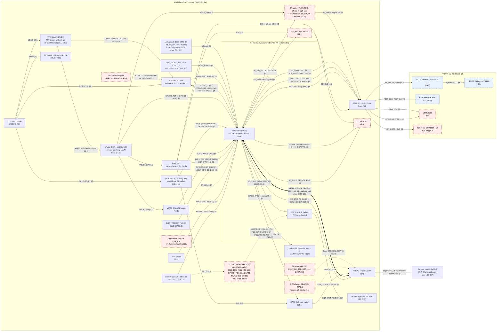
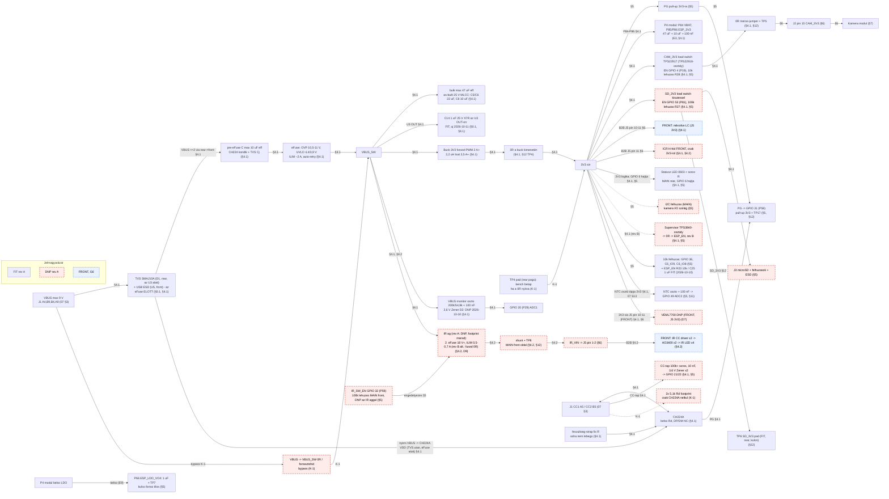
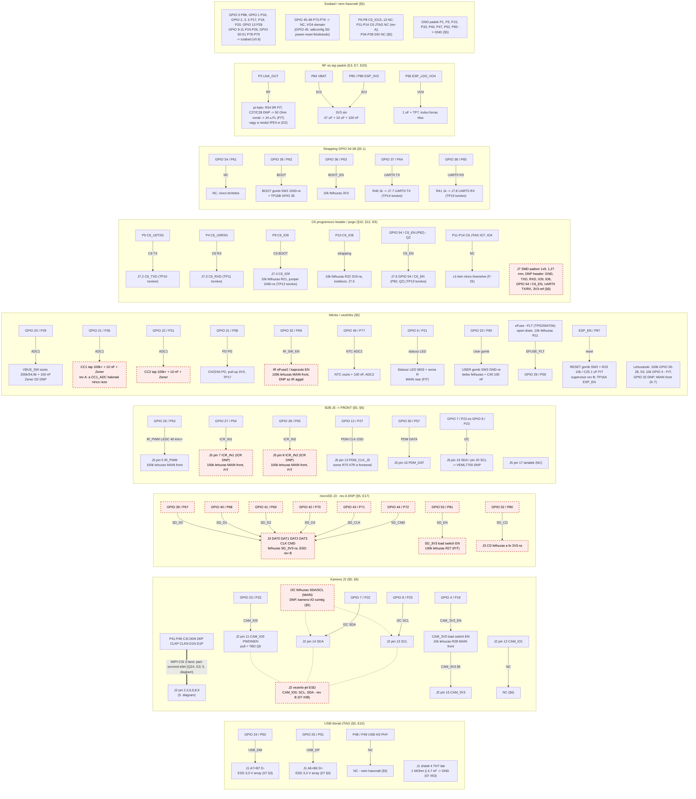
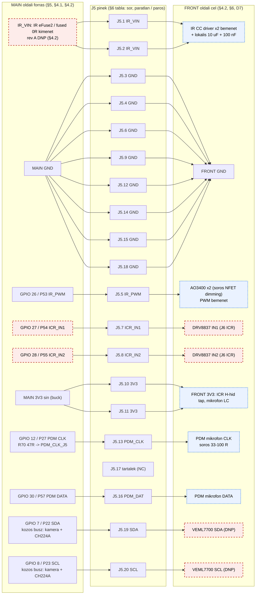
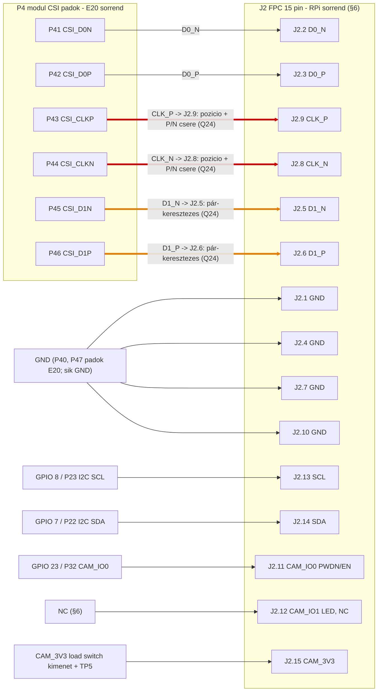
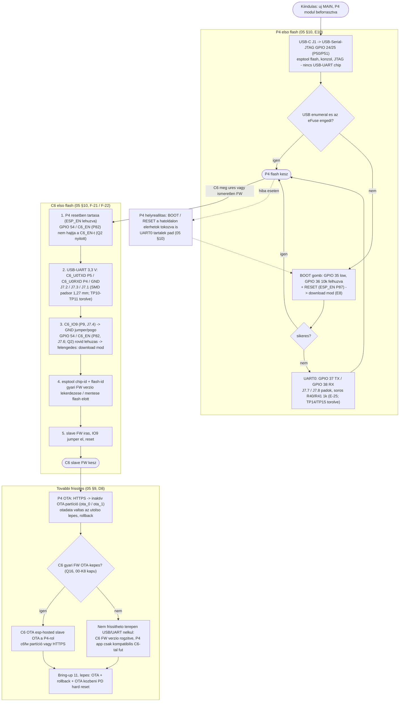

# 08 – Diagramok (Mermaid, v0.4)

Dátum: 2026-10-09 · **v0.4 (2026-10-11): végső rev A as-built – D1 TVS az U3 alatt, U5 / R1 / C1 a front oldalon, új C14, G4 lezárva, G5 rendelés előtti kapu, G5b CSI soak** – lásd „Diagram-javítások (v0.4)” a végén · **v0.3 (2026-10-10): GPIO-kiosztás v0.6 (SD_EN 53, SD_CD 52, CAM_3V3_EN 4, USER 33, EFUSE_FLT 29, PDM_DATA 30), MAIN 45×45 / 4 réteg, as-built TP-k (TP9–TP15 törölve, C6/UART0 a J7 padsoron), 2026-10-10-i döntések (R23/C25 FIT, D2 DNP, R28 10k, kamera vezérlő-ESD → rev B)** – lásd „Diagram-javítások (v0.3)” a végén · Forrás: `05-architektura.md` v0.5 (autoritatív), `06-floorplan-vazlat.md` v0.3, `07-bom-terv.md` v0.2 · **v0.2 (R4): a hibalista javítva, a diagramok a 05/06/07 javított állapotát mutatják** (lásd "Diagram-javítások" a végén) · A diagramok **kizárólag** a 05 táblázataiból / szövegéből épülnek; a 06 és 07 csak a lap-oldal (front / rear) és a pin-térkép kiegészítésére szolgál, ahol a 05 hallgat (ezt az élcímke jelzi).

## Jelmagyarázat (minden diagramra)

| Jelölés | Jelentés |
|---|---|
| Folytonos nyíl, `§n` az élcímkén | a kapcsolat a 05 megadott szakaszában szerepel (`E20` = 05 §1 pad-térkép, `07 §3` = USB-C pin map) |
| Szaggatott nyíl | DNP-ág vagy opcionális kapcsolat (a v0.1 "HIÁNYZIK 05-ből" élei a javítások után mind rögzítve vannak, lásd a hibalistát) |
| Szaggatott **piros** keretű csomópont | rev A **DNP** (05 §0.1; footprint van, nincs beültetve) |
| Szaggatott **kék** keretű csomópont | **később (G6)**, a FRONT lapon (05 §0.1, §0.2) |
| Egyszerű keret | rev A **FIT** |

A modul pad = `P`-szám, processzor láb = `GPIO n` (05 jelölés-szabály). A pin-sorszámozás térbeli elrendezése **[F]** (feltételezés) a footprint-importig (05 §14, 06 §1) – **v0.3: a footprint importálva, a DXF-fel egyezik; a GPIO ↔ pad ↔ háló hozzárendelés a NYÁK U1 padjairól ellenőrizve (05 §5).**

---

## 1. Rendszer blokkdiagram

Megjegyzések: a státusz LED a MAIN hátoldalán van (GPIO 6 hajtja), a J5.17 tartalék (NC). ~~A TVS + USB ESD a MAIN hátoldalon áll~~ → **as-built (2026-10-11): a D1 TVS a hátoldalon, az eFuse (U3) alatt (6,8 mm-re a J1-től, elfogadott eltérés); az U5 USB ESD és az R1/C1 shield RC a front oldalon, a J1 mellett**; a VBUS 3 via-n jut a front oldali eFuse IN-re. Az "SDIO belső" link a modulon belül van (E5: GPIO 14–19 nincs kivezetve, **következtetés**); a P4–C6 között nincs MAIN-routing (D2). A kamera 3V3-át a CAM_3V3 load switch adja (nem a fő 3V3 sín közvetlenül, §7).

---

## 2. Tápfa

Megjegyzés: a supervisor, ICR, VEML7700, NTC és a státusz LED ágak a 05 §4.1 fa 3V3 alatti listájából valók (a "LED-ek" sor a státusz LED-re pontosítva: MAIN hátoldal, GPIO 6); a FRONT oldali fogyasztók a 3V3-at a J5 pin 10–11-en át kapják (§6).

---

## 3. Jel / net térkép a P4 modul padjairól

Megjegyzés: a pad-szám minden sorban a 05 §5 / E20 szerint van; a GPIO ↔ pad összerendelést ellenőriztem (nincs eltérés, lásd a végén).

---

## 4. B2B J5 2×10 pinout (MAIN → FRONT)

Megjegyzések (05 §6 szerint): **as-built: J5 az F alsó élén, (22,5; 40,2), pin 1 (16,785; 42,15) – a FRONT párja ugyanezen X/Y-on (05 §3.1a)**; csak logika + táp; GND a PDM CLK és IR PWM körül; rail-enként ≥2 pin (IR_VIN 2, 3V3 2, GND 8); a J5.17 tartalék (NC) – a státusz LED a MAIN hátoldalán van (GPIO 6); pin 1 / tükrözés a papír-próbán (P-22). A **VEML INT-nek nincs J5 pinje** (05 §5, GPIO 0 szabad), így nincs hozzárendelve.

---

## 5. Kamera J2 15 pin – CSI pad-sorrend és a Q24 eltérés

Piros / narancs él = a pad-sorrend és a J2 sorrend eltérése (05 E20, §6 "CSI pad-sorrend vs J2", Q24, 06-K14). **Piros**: a CLK pár P/N sorrendje fordított (modulon P,N; J2-n N,P) **és** a pár helye is cserélődik; **narancs**: a D1 pár helye cserélődik a CLK párral (D0–CLK–D1 vs D0–D1–CLK).

Opciók a keresztezésre (05 §6): (a) a modul sorrendjéhez illő kamera / FFC adapter; (b) CSI lane / polaritás csere a P4-ben (TRM, **[NEM ELLENŐRZÖTT]**, nem építünk rá); (c) szimmetrikus via-keresztezés a J2 padoknál (rev A mérés). A 05 §13 szabálya ("jelenként max 1 rétegváltás") és a keresztezés ütközne: a 05 §13 kivétel-javaslatot rögzít (a J2 padoknál +1 szimmetrikus via-pár; hibalista 15. ✅). A végleges döntés a **G3-ban** van (kamera kiválasztva), a G2 csak a footprint térbeli sorrendjét adja (hibalista 16. ✅).

---

## 6. NYÁK stack oldalnézet (elölről hátra)

```mermaid
flowchart TB
  classDef dnp fill:#fdecea,stroke:#c0392b,stroke-width:2px,stroke-dasharray:5 5,color:#000
  classDef g6 fill:#eaf2ff,stroke:#1f6feb,stroke-width:2px,stroke-dasharray:2 3,color:#000

  FWD(["ELORE: lencse irany"])

  subgraph FE["FRONT elulso oldal (05 §3, 06 §2.3)"]
    FE0["Lencse-kivagas 16x16 mm, R1 sarok<br/>holder 14x14 + hordo atnyul (A variacio)"]
    FE1["IR LED x4 3535 (2,0 mm)"]:::g6
    FE3["PDM mikrofon, jobb sav + akusztikai port"]:::g6
    FE4["VEML7700 DNP + IR-arnyekolo Cu gyuru"]:::dnp
  end

  FPCB["FRONT NYAK 1,0 mm, 2 reteg (ha eleg)"]

  subgraph FB["FRONT hatoldal (05 §3, 06 §2.4)"]
    FB1["B2B 2x10 fej + 10 uF + 100 nF"]:::g6
    FB2["IR CC driver x2 + AO3400 x2 (2,1 mm)"]:::g6
    FB3["DRV8837 + J6 ICR"]:::dnp
    FB4["Mikrofon LC + CLK soros R"]:::g6
  end

  subgraph GAP["Res G = 7,0 mm (05 §3)"]
    CAM["Kamera modul NYAK 1,2 + hatoldali alk. 2,0 = 3,2 mm<br/>a FRONT hatso sikjahoz fekszik"]
    SP["M2 tavtarto x4, 33,5 mm raszter (szerkezeti elem)<br/>kozeppont (22,5; 25,0) - 2,5 mm-rel a lapkozep alatt (05 §3.1a)"]
    B2B["J5 B2B parosított magasság 7 mm"]
    FFC["Kamera FPC: zart stack 25-30 mm<br/>bring-up 50-100 mm FFC, nyitott stack"]
    LIM["MAIN alkatresz a kamera alatt max 3,3 mm = G - 3,2 - 0,5"]
  end

  subgraph MF["MAIN front oldal (05 §3, 06 §2.2)"]
    MF1["J2 FPC 15 pin"]
    MF2["J5 B2B aljzat (3,5 mm)"]
    MF3["CH224A PD blokk"]
    MF4["eFuse blokk + C14 + bulk (as-built 25 V)"]
    MF13["USB ESD U5 + shield RC R1/C1 (J1 kozeleben)"]
    MF5["Buck + induktor 2,8 mm"]
    MF6["VBUS_SW oszto, NTC"]
    MF7["CAM_3V3 load switch"]
    MF8["IR ag: 2. eFuse + shunt + TP8 (rev A DNP; TP8 front)"]:::dnp
    MF9["microSD J3 + SD_3V3 blokk"]:::dnp
    MF10["J2 vezerlo-jel ESD - rev B"]:::dnp
    MF11["0 Ohm merojumperek (R16 3V3, R50 CAM_3V3; a TP pad hatul)"]
    MF12["GPIO lehuzasok: 100k GPIO 26-28, 53; 10k GPIO 4<br/>(GPIO 32 DNP)"]
  end

  MPCB["MAIN NYAK 45x45, 4 reteg, 0,97 mm<br/>JLC04101H-3313A"]

  subgraph MR["MAIN hatoldal REAR (05 §3, 06 §2.1)"]
    MR1["P4 modul 3,3 mm + 3V3 bulk 47+10 uF + 100 nF"]
    MR2["USB-C J1 3,2 mm"]
    MR3["D1 TVS az U3 eFuse alatt, 6,8 mm a J1-tol (as-built, 05 §0.1, §4.1); VBUS 3 via az U3 IN-re"]
    MR4["u.FL J4 + pi-halo"]
    MR5["BOOT / RESET / USER 2,0 mm"]
    MR6["TP-k: TP1-TP7, TP16A/B, TP17-TP19 = 12 pad, 3 GND (TP8 front, DNP)"]
    MR9["Statusz LED 0603 + R (GPIO 6)"]
    MR7["C6 / UART0 padsor J7 (DNP header)"]:::dnp
    MR8["Supervisor + 0R (rev B)"]:::dnp
  end

  BACK(["HATRA"])

  FWD --> FE
  FE -->|"+ 1,0 mm"| FPCB
  FPCB -->|"hatulso sik"| FB
  FB -->|"7,0 mm"| GAP
  GAP -->|"kamera alatt max 3,3 mm"| MF
  MF -->|"+ 1,0 mm"| MPCB
  MPCB --> MR
  MR --> BACK
```

Összvastagság (06 §3.1): lencse nélkül 2,0 + 1,0 + 7,0 + 1,0 + 3,3 = **14,3 mm**; M12 lencsével **29,3 mm**; Ø8 AF hordóval **17,8 mm**.

---

## 7. Programozás és helyreállítás

---

## 8. Bring-up kapuk G0–G6 (G5b-vel; 05 §0.2)

```mermaid
flowchart TD
  classDef gate fill:#f6f8fa,stroke:#57606a,stroke-width:2px,color:#000

  G0["G0 Dev-kit stream + aram (K-2)<br/>OV5640 MIPI -> ISP -> H.264 -> RTSP esp-hosted C6 WiFi-n<br/>24 h soak, aram allapotonkent, RSSI, sdkconfig + verziok befagyasztasa<br/>Kilepes: stabil stream 24 h, mert tablazat lecsereli a 4.3 becsleseket"]:::gate
  G1["G1 CH224A breakout bench teszt (K-4)<br/>MacBook, olcso PD toltő, USB-A->C kabel<br/>Kilepes: 9 V stabil, PG szint ismert, nincs 20 V, strap-tabla igazolva (Q13)"]:::gate
  G2["G2 Modul sematik + footprint + antenna-dontes<br/>Q1-Q3, Q9-Q11, footprint import (a G2 csak a modul footprintet / sematikat szallitja), antenna (K-6)<br/>Kilepes: footprint + 1:1 papirproba, antenna-dontes, supervisor beultetesi dontes"]:::gate
  G3["G3 Kamera modul befagyasztva + CSI / J2 dontes (Q24)<br/>NoIR / fix lencse, 15 pin, onboard osc + LDO, CAM_IO0 polaritas, I/O szint, STEP, FFC hosszak<br/>vegleges CSI pad-sorrend / J2 pinout (kamera + G2 footprint + TRM lane-csere ellenorzes + via-keresztezes)<br/>Kilepes: egy modul kivalasztva, GPIO 23 pull (Q5) es a CSI / J2 sorrend eldontve"]:::gate
  G4["G4 BOM-lap kesz (07), ellenallas-szamitasok a sematik elott (K-8)<br/>Kilepes: nincs TBD a rev A FIT sorokban<br/>2026-10-11: rev A-ra LEZARVA (72/72 LCSC; Q6, Q17 nyitott)"]:::gate
  G5["G5 MAIN sematik -> layout -> DRC -> 1:1 print -> rendeles (JLC, modul utoljara kezzel)<br/>csak a rendeles elotti kapu utan: refill + mentes, DRC 0, Gerber check-zones (05 §3.1)<br/>Kilepes: MAIN megrendelve"]:::gate
  G5B["G5b Bring-up - MAIN onalloan, kamera 50-100 mm FFC-n (05 §15, 0-7a. lepes, nyitott stack, K-7)<br/>+ CSI soak teszt hibaszamlalokkal, min. 1 h<br/>Kilepes: stabil stream, 24 h reset nelkul, 9 V PD + PG helyes, PD hard reset x20"]:::gate
  G6["G6 FRONT (IR, mikrofon; ICR rev B)<br/>a G5b zarasa utan, kamera STEP-pel, IR bench arnyekolo csovel (K-19)<br/>Kilepes: FRONT megrendelve"]:::gate

  G0 -->|"a következő csak az előző zárása után §0.2"| G1
  G1 --> G2
  G2 --> G3
  G3 --> G4
  G4 --> G5
  G5 --> G5B
  G5B --> G6
  G2 -.->|"footprint terbeli CSI sorrend (csak input)"| G3
```

---

## Rajzolás közben talált eltérések (javítva: 2026-10-09, review kör 4)

Jelölés: ✅ javítva · ❌ téves (a fordított ellenőrzés cáfolta) · ⏳ nyitva. A fordított ellenőrzés (R4) az 1–8., 10–17., 19–22. tételt visszaigazolta; a #9 részben, a #23 részben igaz, a #18 téves volt. A javítások a 05 v0.5 / 06 v0.3 / 07 v0.2 dokumentumokban vannak; a diagramok ezt mutatják. Súly: **H** = tervezési döntést érint, **M** = dokumentum-hiba, **L** = kozmetikai.

| # | Súly | Eltérés (v0.1) | Javítás (hol) | St. |
|---|---|---|---|---|
| 1 | H | TP8 FIT vs DNP (05 §0.1 "TP1–TP17 FIT" vs "TP8 DNP"; 07 #33 vs #20) | 05 §0.1: "TP1–TP7, TP9–TP17" FIT, TP8 külön DNP; 07 #33 | ✅ |
| 2 | M | TP4 / TP5 / TP6 oldala (05 §12 hátoldali csoport vs 06 §4.2 front) | döntés: a TP pad-ok a hátoldali pogo csoportban, a 0 Ω jumperek elöl, via-val kivezetve (05 §12; 06 §2.1/§2.2/§4.2) | ✅ |
| 3 | M | TP9 és TP16 két jelet hordoz → pad-szám | TP9a/b (D+/D−), TP16a/b (ESP_EN/GPIO 35); 18 pad (17 jel + TP3 GND) + 2 GND pad = 20 (05 §12; 06 §2.1: 95 mm²) | ✅ |
| 4 | H | a C6_EN nem külön pad (E20: P82 = GPIO 54) | felirat mindenhol "GPIO 54 / C6_EN (P82)" + Q2 (05 §5, §6, §10, §12; 08); Q2 maga továbbra is nyitott | ✅ felirat ⏳ Q2 (G2) |
| 5 | M | CH224A tápláló lába nincs a fában | 05 §4.1: nyers VBUS (TVS után, eFuse előtt) → CH224A VDD; diagramokon él | ✅ |
| 6 | M | NTC osztó és VEML7700 tápja nincs a fában | 05 §4.1 3V3 lista: NTC osztó (MAIN), VEML7700 (FRONT, J5 3V3, DNP) | ✅ |
| 7 | M | Státusz LED hozzárendelés kikövetkeztetett; "LED-ek" a 3V3 listán | LED a MAIN hátoldalon, GPIO 6 → soros R → LED; J5.17 tartalék (NC); a lista pontosítva (05 §4.1, §5, §6) | ✅ |
| 8 | H | 100k lehúzások helye ellentmondó | minden 100k lehúzás a MAIN hátoldalon, a modul közelében (05 §4.2, §5; 06 §2.1; 06 §2.4 sor törölve) | ✅ |
| 9 | M | J2 vezérlő-jel ESD hiányzik a rev A tervből és a költségvetésből | a **07 #38 már FIT volt** (az állítás ott téves); javítva: 05 §0.1 sor, 06 §2.2 sor (8 mm²) | ✅ (részben téves volt) |
| 10 | M | 05 §0.1 nem fedi le a 07 FIT/DNP sorait | 05 §0.1: VO4 + TP7, strap, 100k lehúzás, UART0 R + GPIO 5, I2C (DNP), J2 ESD, J1 shield RC, Rd (DNP) sorok | ✅ |
| 11 | M | IR ág "rev A" állapota: D9/fa vs §0.1 | rev A: az egész IR ág DNP, footprint marad (05 D9, §4.1, §4.2, §0.1) | ✅ |
| 12 | M | CC ADC rev A-ban DNP, mégis a boot-sorrendben | 05 §4.3 4. szabály, §15 6. lépés: "rev B / ha CC-tap beültetve" | ✅ |
| 13 | M | J7 header pinszám (7 jel vs 07 "1×9") | J7 = 1×9 (+ C6_IO8, 3V3-ref); pin-tábla 05 §6; 07 #32 | ✅ |
| 14 | M | 07 BOM-ból hiányzó passzív-csoportok | 07 #53–#60 (shield RC, 100k lehúzások nets, UART0 R, GPIO 5 100 nF, CH224A tápkondik, CAM_3V3 0 Ω, buck FB, eFuse OVP/UVLO/ILIM) | ✅ |
| 15 | H | CSI keresztezés vs "max 1 rétegváltás" | 05 §13: kivétel-javaslat (J2 padoknál +1 via-pár, G3 dönt, [NEM ELLENŐRZÖTT]) | ✅ szabály ⏳ Q24 (G3) |
| 16 | H | G2 és G3 körkörös | a CSI/J2 döntés a G3-ba került; a G2 csak footprintet / sematikát szállít (05 §0.2, §6, §14, Q24; 06 K12/K14) | ✅ |
| 17 | H | Nincs kapu a bring-up és a G6 között | új G5b kapu (05 §0.2); a G6 a G5b zárása után | ✅ |
| 18 | L | J5 szomszédság vs EMC-szabály | **téves**: az IR_PWM (J5.5) mellett GND áll (sor-pár J5.6, oszlop-szomszéd J5.3), a PDM_CLK (J5.13) mellett is (sor-pár J5.14, oszlop-szomszéd J5.15) → a "GND-vel elválasztva" szabály teljesül | ❌ téves |
| 19 | M | Pinmap hiányzik több csatlakozóhoz | 05 §6: J3 (microSD), J4 (u.FL), J6 (ICR), J7 pin-táblák | ✅ |
| 20 | L | Nem hivatkozott modul padok | 05 §5: P6–P8 NC, P11–P14 NC, P34–P39 NC, GND padok P1/P3/P15/P33/P40/P47/P52/P83 → GND | ✅ |
| 21 | M | TVS / USB ESD oldala nincs a 05-ben | 05 §3, §4.1: a MAIN hátoldalon a J1 mellett; VBUS ≥2 via-n a front eFuse-hoz | ✅ |
| 22 | L | 06-K5 számtani | 06 K5: nettó 242 mm² (PD 80 + eFuse 76 + buck 86); IR ággal (52) ≈ 294 ≈ 295 | ✅ |
| 23 | L | Dokumentum-hivatkozás (Q26 / Q15 a §0.4-ben) | csak a **Q26** hiányzott a 05 §0.4-ből; felvéve, a Q15 👤 jelölés pótolva | ✅ (részben téves volt) |

### Diagram-javítások (R4)

| Diagram | Javítás |
|---|---|
| 1. blokkdiagram | a TPC6 csomópont szétbontva: C6 pogo pad TP10–TP13 (FIT) és J7 1×9 (DNP, szaggatott él); a CSI él jelöli a Q24 pad-sorrend eltérést; státusz LED a MAIN-en (GPIO 6), a J5-ös él törölve; új csomópontok: J2 ESD, J1 shield RC, 100k lehúzások, Rd footprint (DNP), I2C felhúzás (DNP); TVS/ESD "MAIN rear"; nyers VBUS → CH224A VDD |
| 2. tápfa | az SDB csomópontból kivéve a TP6 (külön FIT pogo pad csomópont); az IR_SW_EN csomópont (ID: IRSWEN) DNP stílusú; a "LED-ek" → státusz LED (GPIO 6 hajtja, MAIN rear); NTC és VEML7700 3V3 él megrajzolva; CH224A VDD él; Rd és I2C felhúzás (DNP) |
| 3. net térkép | státusz LED a MAIN-en; J5.17 tartalék; lehúzások MAIN rear; J2 ESD, I2C felhúzás (DNP), shield RC, TP9a/b, TP16a/b, J7 1×9, nem használt padok (NC / GND); "GPIO 54 / C6_EN (P82)" |
| 4. J5 | J5.17 tartalék (NC), a státusz LED él és csomópont törölve |
| 5. CSI | a szöveg a G3-ba tett döntést és a 05 §13 kivétel-javaslatot tükrözi |
| 6. stack | státusz LED a MAIN hátoldalon; pogo csoport 18 pad + 2 GND; J2 ESD, 0 Ω jumperek a front oldalon; IR ág DNP |
| 7. programozás | "GPIO 54 / C6_EN (P82)" felirat |
| 8. kapuk | G5b hozzáadva; a CSI/J2 döntés G3-ban; a G2→G3 körkörösség és a "HIÁNYZIK" élek megszűntek |

**Ellenőrizve, eltérés nem volt:** a 05 §5 minden GPIO ↔ pad párja egyezik az E20-szal (GPIO 2–13 → P17–P28; GPIO 20–23 → P29–P32; GPIO 24/25 → P50/P51; GPIO 26–38 → P53–P65; GPIO 39–54 → P67–P82; GPIO 0 → P88, GPIO 1 → P16); a 06 §1 pad-oldal hozzárendelése (22 pad/oldal) konzisztens az E20-szal és a 05 §14-gyel; a J5 mind a 20 pinje kiosztott (a 17-es tartalék); az 05 §4.3 táblázat számai újraszámolva egyeznek; a 06 §2.1–§2.4 területösszegek (v0.3: 429,2 / 819 / 95,7 / 315 mm²) és a §3.1 vastagság-összegek helyesek; 07 S11 (9,45 V × 54/254 = 2,01 V) és S6 (47 µF × 30 mV/µs = 1,41 A) helyes.

### Diagram-javítások (v0.3, 2026-10-10 – GPIO v0.6 + as-built)

Forrás: a MAIN v0.6 NYÁK (U1 pad ↔ háló, a séma-szimbólum lábneveivel összevetve) és a `05` v0.6 as-built; a 7. kör review döntései (`05` §0.1).

| Diagram | Javítás |
|---|---|
| 1. blokkdiagram | CAM_3V3_EN GPIO 33 → **4 (P19)**; SD_EN GPIO 29 → **53 (P81)**; PDM DATA GPIO 13 → **30**; USER gomb GPIO 5 → **33**; új élek: EFUSE_FLT → GPIO 29 (P56), SD_CD → GPIO 52 (P80), CH224A I2C (GPIO 7/8, csak olvasás); a TP10–TP13 / TP14–TP15 csomópont törölve → J7 padsor (DNP header) + R40/R41; J2 vezérlő-ESD → rev B (szaggatott); supervisor rev B; új ESP_EN RC csomópont (R23/C25 FIT); lehúzások: 100k GPIO 26–28, 53 + 10k GPIO 4, MAIN front; MAIN 45×45, 4 réteg |
| 2. tápfa | CAMSW EN GPIO 4 (10k R28), SDSW EN GPIO 53 (100k R27); VBUS monitor: Zener D2 DNP; IR_SW_EN lehúzás MAIN front; TP6 külön pad; supervisor rev B; ESP_EN RC a felhúzás-csomópontban |
| 3. net térkép | TP9a/b törölve; CAMG: GPIO 4 / P19 → CAM_3V3_EN (10k), J2 ESD rev B; SDG: GPIO 53 / P81 SD_EN, GPIO 52 / P80 SD_CD; B2BG: GPIO 30 / P57 PDM DATA, R70 47R, lehúzások front; MON: GPIO 33 / P60 USER, új GPIO 29 / P56 EFUSE_FLT, ESP_EN RC FIT, CC1_ADC réz nincs; C6G: TP10–TP13 → J7.2–J7.6; STRP: UART0 → R40/R41 → J7.7/J7.8; RF: R34/J4 FIT; szabad padok v0.6 szerint (GPIO 0, 1, 2, 3, 5, 9–11, 13, 50, 51) |
| 4. J5 | PDM DATA GPIO 13 → 30 (P57); PDM CLK R70 47R → PDM_CLK_J5; az I2C közös busz (kamera + CH224A); J5 as-built pozíció |
| 6. stack | MAIN 45×45, 4 réteg, 0,97 mm (3313A); M2 raszter középpontja (22,5; 25,0); TP-k 12 pad; lehúzások a MAIN front oldalon; J2 ESD és supervisor rev B |
| 7. programozás | UART0 és C6 UART / IO9 / EN: J7 padok (TP10–TP15 törölve) |
| 8. kapuk | G4: 2026-10-10-én nyitott (0 MPN, helyőrző lábképek) |

**Nem változott (ellenőrizve):** 5. CSI diagram (a pad- és J2-lábkiosztás egyezik a NYÁK-kal); a J5 mind a 20 pinje a NYÁK-on is a §6 tábla szerint (J5.13 = PDM_CLK_J5, J5.17 NC). ~~**Tudatosan nem frissítve:** a TVS / USB ESD / shield RC oldal-feliratai (1., 2., 6. diagram „MAIN rear, J1 mellett”) … a layout-javító kör után igazítandó.~~ → a v0.4-ben javítva (lent).

### Diagram-javítások (v0.4, 2026-10-11 – végső rev A as-built, 9. kör)

Forrás: a `05` végső as-built (§0.1, §4.1, §15) és a `90-review-log.md` 9. kör. Csak a végső állapottal ellentmondó feliratok változtak.

| Diagram | Javítás |
|---|---|
| 1. blokkdiagram | TVS: „J1 mellett” → **D1, MAIN rear, az eFuse (U3) alatt**; USB ESD: „MAIN rear” → **U5, MAIN front, a J1 mellett**; a megjegyzés as-built-re javítva |
| 2. tápfa | TVS-csomópont: D1 (rear, U3 alatt) + U5 (front); **új C14 csomópont** (1 µF / 25 V az U3 OUT-on, FIT); bulk: „35–50 V” → as-built 25 V MLCC |
| 6. stack | MF4: eFuse blokk + C14 + 25 V bulk; **új MF13**: U5 + R1/C1 a front oldalon; MR3: D1 TVS az U3 alatt, 3 VBUS via |
| 8. kapuk | G4: rev A-ra lezárva (72/72 LCSC; Q6, Q17 nyitott); G5: rendelés előtti kapu; G5b: CSI soak teszt hibaszámlálókkal |

A kamera / SD / CC ESD a diagramokon eddig is rev B (szaggatott) – a CC clamp nem szerepel csomópontként, a `05` §0.1 rev B sora rögzíti.
